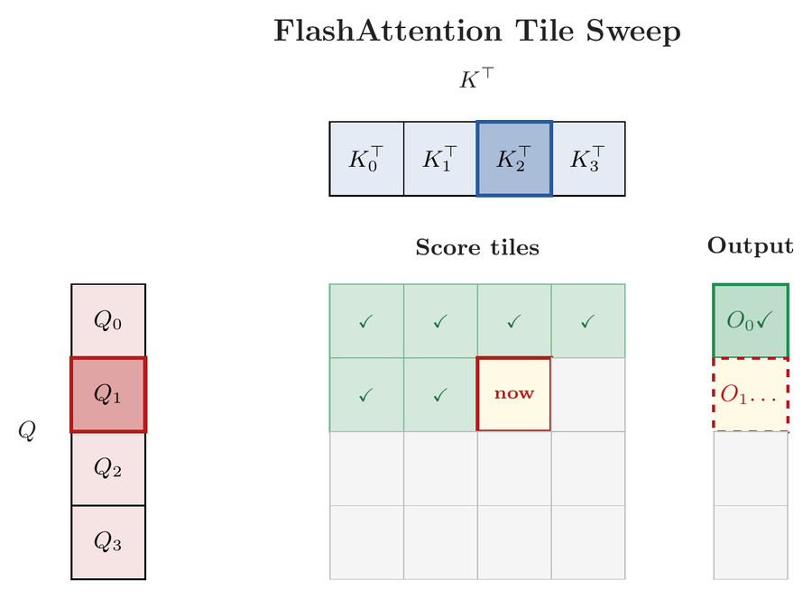
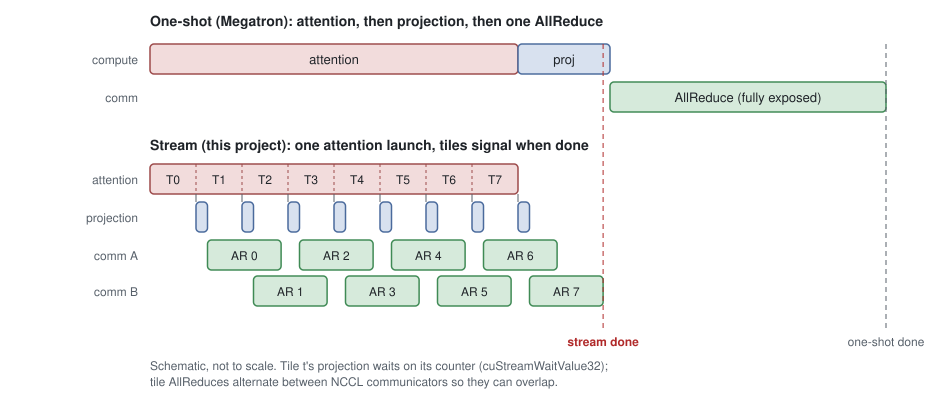
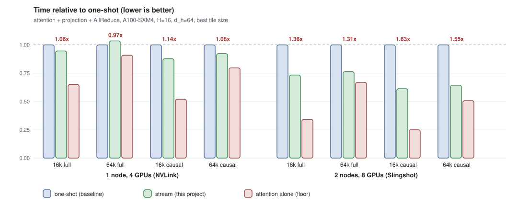

# eager-flash-attention

Start the tensor-parallel AllReduce while FlashAttention is still running. CUDA + NCCL, tested on NERSC Perlmutter A100s.

## The idea

Tensor parallelism splits attention heads across GPUs. Each GPU computes a partial output for its heads, then an AllReduce adds the partials up. Normally the AllReduce waits until all attention is done, so the communication time sits on top of the compute.

But FlashAttention doesn't finish the output all at once. It finishes one block of rows at a time, top to bottom:

<p align="center"></p>

The output projection and the AllReduce work row by row, so a finished block of rows (a *tile*) can be projected and AllReduced right away, while attention keeps working on the rest:



Same total communication, but most of it is hidden behind attention.

## How it works

- **One attention launch.** Launching attention once per tile keeps the GPU underused, so the whole sequence runs in a single launch.
- **Tiles signal from inside the kernel.** When a thread block finishes its rows, it calls `__threadfence()` (so its writes are visible) and then `atomicAdd`s a per-tile counter.
- **The GPU waits, not the CPU.** For each tile, the projection stream runs `cuStreamWaitValue32` on that tile's counter, then the projection GEMM, then the AllReduce. Everything is queued up front, and no SM spins while waiting.
- **Tiles finish in order.** The grid is laid out so row block 0 is scheduled before row block 1, and so on.
- **Several NCCL communicators.** Tile AllReduces rotate across communicators so they can overlap instead of queuing. This was essential across nodes.

The attention kernel uses tensor cores (fp16 `mma.sync`, `ldmatrix`, `cp.async`). Every mode is checked against a cuBLAS + full-softmax reference on 1 and 8 GPUs.

## Results



The baseline is one-shot (Megatron-style): attention, then projection, then one AllReduce. `H=16`, `d_h=64`, 16k–64k tokens, median of 5 trials (`results/core_*.csv`).

- **2 nodes, 8 GPUs: 1.31–1.36x faster, 1.55–1.63x with causal masking.** Across nodes the AllReduce costs more than attention, so there's a lot to hide.
- **1 node, 4 GPUs: roughly break-even (0.97–1.14x).** NVLink makes communication cheap, so there's little to hide.
- **Causal helps more.** Early tiles finish early, so communication starts sooner, and there's less attention work overall.
- **Overlap isn't free.** An NCCL AllReduce block needs a whole SM, so it can't run next to a busy attention kernel and has to wait for attention blocks to finish. A simple cost model (`cost_model.py`) predicts the 2-node times within 1–9%, but on 1 node it underestimates by 12–55% because of this.

## Running it (Perlmutter)

```
source perlmutter/env.sh          # modules + NCCL_PROTO=Simple (small inter-node AllReduces hung without it)
bash perlmutter/build.sh          # builds into ./build
sbatch -N 1 perlmutter/tests.sbatch
sbatch -N 2 perlmutter/bench.sbatch
```

`attn_bench --help` lists the options (`--S`, `--tile`, `--split`, `--ncomm`, `--causal`, `--modes attn,megatron,stream`, ...). `bench_sweep.py` runs the sweeps, and `bench_tables.py` / `docs/make_figures.py` turn the CSVs into tables and figures.

| File | What it is |
|---|---|
| `flash_attn_tc.cu` | Tensor-core FlashAttention kernel with per-tile completion counters |
| `flash_attn.cu` | The original fp32 kernel (`--kernel v1`) |
| `run_drivers.cu` | The execution modes: `attn`, `megatron` (one-shot), `sync`, `overlap` (one launch per tile), `stream` (this project) |
| `attn_main.cu` | MPI/NCCL/cuBLAS setup |
| `attn_tests.cu`, `attn_bench.cu` | Correctness tests and the benchmark driver |

## Related work

Tile-level overlap of compute with collectives is an active area, and the dataflow here has close relatives:

- **FlashOverlap** (Hong et al., EuroSys '26) uses the same signal: GEMM tiles bump an atomic counter and unmodified NCCL calls are released when a group of tiles is done. It overlaps GEMMs rather than attention, waits with a polling kernel rather than `cuStreamWaitValue32`, and is evaluated on a single node.
- **FastAttention** (Huawei, 2024) fuses attention and the output linear and AllReduces each block of query rows as it finishes, on Ascend NPUs, where a DMA engine moves the data so communication does not compete with compute.
- **T3** (Pati et al., ASPLOS '24) proposes hardware that tracks stores to an output buffer and triggers DMA transfers, so communication uses no compute units.
- GEMM-side overlap: Flux (fuses communication into GEMM kernels), PyTorch async tensor parallelism (copy-engine micro-pipelining), NVIDIA Transformer Engine's userbuffers overlap, and Domino.

What this prototype adds is the combination: FlashAttention as the producer for head-parallel tensor parallelism on NVIDIA GPUs, a wait performed by the GPU front end with no polling kernel, several NCCL communicators in flight, results across nodes, and the measurement that NCCL's AllReduce needs whole SMs, which is why the overlap breaks even on one NVLink node.
